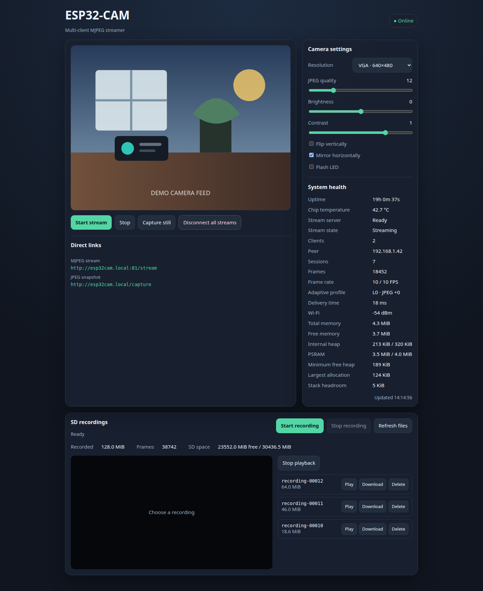
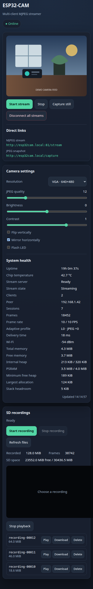

# ESP32-CAM Multi-Client Streamer

[](https://github.com/Medzoner/domoticz-esp32cam/actions/workflows/ci.yml)
[](https://github.com/Medzoner/domoticz-esp32cam/actions/workflows/release-please.yml)
[](https://github.com/Medzoner/domoticz-esp32cam/releases)
[](LICENSE)

PlatformIO firmware for several ESP32 camera boards. It provides a responsive
control interface, JPEG snapshots, and one shared MJPEG stream for multiple
consumers such as MotionEye, Home Assistant, and OctoPrint.

## Features

For reliability boundaries, sanitizer checks and reproducible hardware stress
tests, see the [reliability contract](docs/RELIABILITY.md). Build support does
not imply hardware validation or certification by Espressif.

- Up to four simultaneous MJPEG clients
- Fixed-rate 10 FPS stream to limit CPU and network usage
- Runtime camera controls for resolution, JPEG quality, brightness, contrast,
  vertical flip, and horizontal mirror
- Health telemetry for Wi-Fi, heap usage, stream rate, sessions, and task stack
  headroom
- Static IPv4 configuration, DHCP hostname, and mDNS discovery
- First-boot provisioning portal with network scanning and captive portal
  detection
- Manual SD-card recording with segmentation, file management, download, and
  browser playback on AI Thinker ESP32-CAM
- Same-origin checks and rate limiting on the control interface
- Native unit tests and Cppcheck static analysis
- GitHub Actions CI and tagged firmware releases

## Web Interface

The responsive dashboard keeps the live stream, camera controls, recording
management, and system health visible from desktop and mobile browsers.

| Desktop | Mobile |
|---|---|
| [](docs/images/ui-dashboard.png) | [](docs/images/ui-mobile.png) |

> The screenshots use a simulated camera feed and demonstration telemetry; no
> real camera image, credentials, or network details are included.

## Streaming Performance

The camera uses two PSRAM frame buffers with latest-frame capture to minimize
latency. The MJPEG server combines each multipart boundary and JPEG header into
one TCP write, then sends image data in 16 KiB blocks. This reduces socket calls
while retaining a bounded timeout for slow consumers.

The stream task reserves one reusable 512 KiB PSRAM delivery buffer at startup.
It copies each JPEG, returns the driver's frame and releases the camera mutex
**before** sending it to clients or recording it to SD. Network and storage
stalls can still delay the stream task, but no longer retain the camera mutex.
This costs one bounded copy per captured frame and 512 KiB of persistent PSRAM;
there is no per-frame allocation and no fallback to the internal RAM heap.

If the PSRAM reservation fails, `/health` reports the stream service as failed
and HTTP controls remain available. JPEGs larger than the configured capacity
are dropped whole, never truncated. Inspect `stream_frame_capacity`,
`stream_dropped_frames` and `stream_oversized_frames` in `/health`; lower
resolution or increase the numeric JPEG quality value if oversized drops rise.
The cap applies to live video and SD recording; snapshots use their own path.

The browser interface uses asynchronous image decoding and automatically
reconnects with exponential backoff after a stream interruption. It disconnects
its own stream while the page is hidden, which avoids wasting Wi-Fi bandwidth,
browser decoding time, and ESP32 processing capacity in background tabs.

The default 10 FPS cap favors stable multi-client delivery over maximum frame
rate. JPEG quality has the greatest effect on bandwidth; increase the numeric
quality value when more simultaneous clients or a weaker Wi-Fi signal require
smaller frames.

### Adaptive resource controller

The stream server evaluates system pressure every two seconds from the active
client count, average frame delivery time, Wi-Fi RSSI, free heap, and socket
write failures. It selects one of five profiles ranging from 10 FPS at the
configured JPEG quality to an emergency 4 FPS profile with additional JPEG
compression.

Degradation is immediate when pressure rises. Recovery requires three healthy
evaluation windows per level, which prevents rapid profile oscillation. The
configured JPEG quality remains the user's baseline; adaptive compression is a
temporary offset and is removed when conditions recover. `/health` and the web
interface expose the target FPS, delivery time, quality offset, and pressure
level.

The web interface renders telemetry from `/health` as a system health
panel. It refreshes every two seconds, prevents overlapping requests, disables
HTTP caching, and pauses polling while the browser tab is hidden.

## Hardware

Supported camera boards require PSRAM:

| PlatformIO environment | Camera board |
|---|---|
| `esp32cam` | AI Thinker ESP32-CAM |
| `esp-eye` | Espressif ESP-EYE |
| `esp32s3-cam-lcd` | Espressif ESP32-S3 CAM LCD |
| `m5stack-camera` | M5Stack Camera PSRAM |

Use a compatible camera sensor such as the OV2640 and a USB-to-serial adapter
for initial flashing when the board does not expose native USB.

SD recording currently targets the built-in microSD slot on the AI Thinker
ESP32-CAM. It uses `SD_MMC` in 1-bit mode, leaving GPIO 4 available and reducing
pin conflicts. Other board environments expose the streaming features but mark
recording as unsupported until their storage wiring is defined and validated.

## Configuration

For the MJR1 format, interrupted-recording behavior and a non-destructive host
recovery tool, see [recording integrity and recovery](docs/RECORDINGS.md).

During SD lock contention, `/health` marks `recording_stats_valid: false`; do
not interpret the recording counters in that response as an idle or empty card.
The dashboard displays an unknown/retrying state. Stop/list requests return
HTTP 503 when they cannot be accepted instead of silently reporting success.

Create the local configuration file:

```bash
cp include/secrets.example.h include/secrets.h
```

Set the Wi-Fi credentials, hostname, static address, and gateway in
`include/secrets.h`. This file is ignored by Git and must never be committed.

The same file also holds `CAMERA_SETUP_AP_PASSWORD` for the onboarding access
point.

Authentication is optional. Leave `CAMERA_AUTH_USERNAME` and
`CAMERA_AUTH_PASSWORD` empty to keep the trusted-LAN behavior, or set both to
enable HTTP Basic login. A successful login creates a random per-boot session
cookie shared by ports 80, 81, and 82, so the browser does not prompt again when
opening the live stream or recording player. A username cannot contain `:`.

The default hostname in the example configuration is `octoprint-cam`. Once the
device is online, supported clients can reach it at
`http://octoprint-cam.local`.

## First Boot Onboarding

The firmware starts a provisioning portal instead of the camera stack when
`WIFI_SSID` still holds the placeholder `your-wifi`, or when the stored
credentials fail to associate:

1. The board publishes the `<hostname>-setup` access point (`esp32cam-setup` as
   a fallback), protected by `CAMERA_SETUP_AP_PASSWORD` when a value is set.
2. Connect from a phone or laptop and open any address. A wildcard DNS server
   redirects the request to the portal, so no URL has to be remembered.
3. Use **Scan networks** to list nearby access points, then submit the network
   name and passphrase. The form accepts open networks and WPA2 passphrases of
   8 to 63 characters, or a 64 character hexadecimal key.
4. The camera stores the credentials in NVS and reboots into station mode.

Provisioning stops after 2.5 seconds once credentials are saved, or after ten
minutes without a submission when the portal was opened by a failed connection.

## Local Development

Contributions are welcome. Read [CONTRIBUTING.md](CONTRIBUTING.md) for the full
setup, architecture, validation, commit, and pull request guidelines. Please use
the issue forms before starting a large feature or a new board port.

Install the pinned CI toolchain:

```bash
python -m pip install --requirement requirements-ci.txt
```

Run the project checks:

```bash
pio test --environment native
pio check --environment native
pio check --environment esp32cam
pio run --environment esp32cam
```

Build another supported board by selecting its environment, for example:

```bash
pio run --environment esp-eye
pio run --environment esp32s3-cam-lcd
pio run --environment m5stack-camera
```

Flash and monitor a connected board:

```bash
pio run --environment esp32cam --target upload
pio device monitor --baud 115200
```

PlatformIO detects the upload and monitor ports. Override the port on the
command line when automatic detection is not suitable.

## HTTP API

The control server listens on port 80:

| Method | Path | Access | Description |
|---|---|---|---|
| `GET` | `/` | Optional auth | Responsive camera interface |
| `GET` | `/health` | Optional auth | Device, Wi-Fi, memory, stream, and recording telemetry |
| `GET` | `/status` | Optional auth | Current camera settings |
| `GET` | `/capture` | Optional auth | One JPEG snapshot |
| `POST` | `/control?var=<name>&val=<value>` | Optional auth + same origin | Update one validated camera setting |
| `POST` | `/stream-stop` | Optional auth + same origin | Disconnect all MJPEG consumers |
| `POST` | `/recording/start` | Optional auth + same origin | Start a new SD recording |
| `POST` | `/recording/stop` | Optional auth + same origin | Flush and stop SD recording |
| `GET` | `/recordings` | Optional auth | List recordings while recording is stopped |
| `POST` | `/recording/delete?id=<id>` | Optional auth + same origin | Delete one stopped recording |

Mutating browser requests require an `Origin` or `Referer` header that matches
the camera's own `Host`, accept only `POST`, and are limited to one accepted
mutation every 250 ms. Trusted non-browser IoT clients may omit those headers.

The multi-client MJPEG stream listens separately on port 81 and stays open so
existing consumers keep working:

```text
http://octoprint-cam.local:81/stream
```

Recorded-file playback and download use a separate server on port 82. Keeping
this work away from the control server means a long playback cannot block
health checks or camera commands.

`/health` includes `stream_service` and `playback_service` startup states
(`not_started`, `starting`, `running`, `failed`). Its `status` is `ok` only when
both services are running, otherwise `degraded`. The diagnostic endpoint remains
HTTP 200; readiness monitors must inspect the JSON status. Failed video/playback
startup leaves HTTP controls available for diagnosis rather than rebooting the
device repeatedly. Recording start returns HTTP 503 if video is not running.

## SD Recording

Use the **SD recordings** panel in the web interface, or call the start and stop
endpoints from Domoticz or another trusted IoT client. Recording also works when
there are no live stream viewers because the stream task continues capturing
frames while a recording is active.

Recordings are split at 64 MiB and stored as `recording-NNNNN.mjr`. The MJR
container stores the original JPEG frames without re-encoding. The integrated
player serves those frames back as MJPEG at approximately 10 FPS. Files can be
listed, played, downloaded, and deleted from the browser after recording stops.
The firmware reserves 8 MiB of free space and stops with an error instead of
deleting existing recordings automatically.

For an authenticated Domoticz or command-line integration, send HTTP Basic
credentials with each request, for example:

```bash
curl --user camera:your-password --request POST \
  http://octoprint-cam.local/recording/start
```

## Security

The camera is a plain HTTP device intended for an isolated, trusted IoT
network. Optional authentication limits access but does not encrypt credentials,
video, or commands. Network segmentation and firewall policy remain the main
security boundary. When authentication is disabled, every host on the segment
can read the video feed and invoke the API.

- `/control` and `/stream-stop` accept `POST` only. The camera compares the
  `Origin` (or `Referer`) header against its own `Host` and answers `403` for a
  foreign browser origin, which blocks cross-site requests.
- Mutations are rate limited to one accepted change every 250 ms, and numeric
  values go through a strict integer parser instead of `atoi()`.
- `/capture` copies the frame out of the camera buffer before writing to the
  network, so a slow client can no longer hold the camera mutex.
- The MJPEG accept path drains request headers under a 250 ms deadline and a
  1 KiB byte budget, so a client that streams headers forever cannot block the
  stream task.
- Responses no longer send `Access-Control-Allow-Origin: *`. The interface also
  sets `X-Content-Type-Options`, `X-Frame-Options`, and `Referrer-Policy`.
- Authentication can stay disabled for legacy OctoPrint, MotionEye, and other
  trusted IoT consumers, or protect all three HTTP ports when configured.

Known residual risks: no TLS, Basic credentials are only encoded rather than
encrypted, and there is no secure boot or flash encryption. Do not expose the
device directly to an untrusted LAN or the Internet.

## Architecture

Dependencies point from adapters toward the core and ports:

- `src/core/<responsibility>/` contains platform-independent rules for auth,
  camera controls, HTTP, provisioning, recording, and streaming.
- `src/ports/<responsibility>/` defines the authentication, camera, and
  recording contracts consumed by adapters.
- `src/adapters/<responsibility>/` isolates camera hardware, HTTP, networking,
  provisioning, recording/SD, security, and streaming implementations.
- `src/config/*_config.h` keeps compile-time settings split by responsibility
  instead of exposing one global configuration header.
- `web/` contains separate HTML, CSS, and JavaScript sources plus a versioned
  snapshot of the shared `esp-ui-kit` design system.
- `scripts/embed_web_assets.py` combines those files into self-contained pages
  in the PlatformIO build directory for reliable captive-portal use.
- `src/main.cpp` is the composition root.
- `test/test_core/` contains native Unity tests.

## Continuous Integration

`.github/workflows/ci.yml` runs on pull requests and pushes to `main`. It:

1. installs the pinned PlatformIO version;
2. creates a build-only configuration from `secrets.example.h`;
3. runs native unit tests;
4. runs native and ESP32 Cppcheck analysis;
5. builds firmware for every supported camera board; and
6. uploads the board-specific firmware artifacts for 14 days.

Third-party actions are pinned to full commit SHAs with the release version in
a trailing comment. The release workflow grants `contents: write` only to the
publishing job and validates the release tag against `v<major>.<minor>.<patch>`
before creating anything.

## Releases

Releases are automated with Release Please. Conventional Commit titles determine
the next Semantic Version, and merging the generated release pull request creates
the tag, changelog, GitHub Release, checksums, and firmware assets.

Maintainers can still push a semantic version tag as a recovery path:

```bash
git tag v1.0.0
git push origin v1.0.0
```

The release includes a board-specific application binary for every supported
PlatformIO environment. It also includes a compressed AI Thinker flashing
bundle containing the bootloader, partition table, OTA bootstrap, application
firmware, checksums, and the complete `esptool.py` command with the required
flash offsets.

The release workflow can also be started manually for an existing tag from the
GitHub Actions interface. See [the release guide](docs/RELEASING.md) for the
complete lifecycle and verification checklist.

## Community

- Read [CONTRIBUTING.md](CONTRIBUTING.md) before opening a pull request.
- Ask usage questions in [GitHub Discussions](https://github.com/Medzoner/domoticz-esp32cam/discussions).
- Use the structured issue forms for bugs, features, and board support.
- Report vulnerabilities privately according to [SECURITY.md](SECURITY.md).
- Participation is governed by the [Code of Conduct](CODE_OF_CONDUCT.md).

## License

This project is available under the [MIT License](LICENSE).
